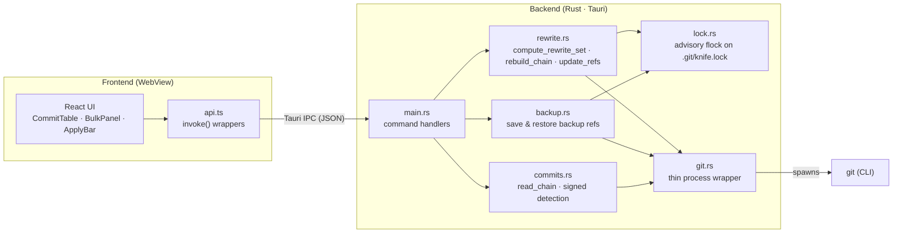
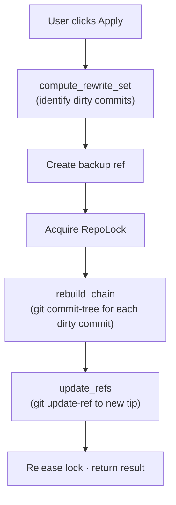

# Architecture

> A high-level map of git-knife for contributors and auditors.

---

## System Overview

git-knife is a **Tauri 2** desktop application that provides a graphical interface for rewriting Git commit metadata (author, committer, message, dates) without altering file content. It is structured as a two-process architecture: a **Rust backend** (`src-tauri/`) that shells out to `git` and performs all repository mutations, and a **React + TypeScript frontend** (`src/`) that renders the UI and sends IPC commands to the backend.

---

## Modules

### Frontend (`src/`)

| File | Purpose |
|---|---|
| `App.tsx` | Application root. State management for repo, commits, edits, branches, backups. Orchestrates bulk apply & confirm flow. |
| `api.ts` | Typed wrappers around `invoke()` — the Tauri IPC bridge. Each function maps to a `#[tauri::command]` on the backend. |
| `types.ts` | Shared TypeScript interfaces: `Commit`, `CommitEdit`, `FieldChange`, `ApplyResult`, `Backup`, etc. |
| `bulk.ts` | Pure-function bulk find & replace engine with ReDoS protection (`checkRegexSafety`, `escapeRegExp`, execution timeout). |
| `components/CommitTable.tsx` | Virtualized commit list with expandable per-commit editor rows. |
| `components/BulkPanel.tsx` | Bulk find & replace UI: field checkboxes, regex toggle, case sensitivity, live preview. |
| `components/ApplyBar.tsx` | Sticky bottom bar showing pending edit count, apply/reset buttons, and confirmation dialog with diff preview. |
| `components/BackupPanel.tsx` | Sidebar listing backup refs with one-click restore. |
| `components/DateField.tsx` | Combined datetime-local + UTC offset input. |

### Backend (`src-tauri/src/`)

| File | Purpose |
|---|---|
| `main.rs` | Entry point. Registers all Tauri commands and module imports. |
| `git.rs` | Thin wrapper around `std::process::Command` for invoking `git`. All repository I/O funnels through here. |
| `commits.rs` | `read_chain`: reads the full commit log for a branch using `git log --format`. Detects signed commits via `git cat-file --batch`. |
| `rewrite.rs` | Core rewrite engine. See [Rewrite Algorithm](#rewrite-algorithm) below. |
| `backup.rs` | Creates timestamped backup refs (`refs/knife-backup/...`) before rewriting, and restores them on demand. |
| `lock.rs` | RAII advisory file lock (`flock` on `.git/knife.lock`) preventing concurrent git-knife operations on the same repository. |

---

## Rewrite Algorithm

The rewrite engine in `rewrite.rs` rewrites commit metadata without altering any file content. It works in three phases:

### Phase 1: `compute_rewrite_set`

Starting from the full commit chain (topologically sorted, root-first), determine which commits need rewriting:

1. A commit is **directly edited** if the user provided overrides for it.
2. A commit is **transitively dirty** if any of its parents were rewritten (because its parent hash changed, the commit's own hash must change too).

This produces a `HashSet<String>` of all commits that need new hashes.

### Phase 2: `rebuild_chain`

Walk the commit chain root-to-tip. For each commit in the rewrite set:

1. Build a `CommitTreeConfig` struct with the commit's tree, all parent hashes (substituting rewritten parent hashes from the `old→new` mapping), environment variables for author/committer metadata, and the commit message.
2. Call `git commit-tree` with the config to produce a new commit object.
3. Record the `old_hash → new_hash` mapping.

Merge commits are handled naturally: all parent hashes are resolved through the mapping, preserving the full DAG topology.

### Phase 3: `update_refs`

Update the branch ref to point to the new tip commit using `git update-ref`.

---

## IPC Contract

All frontend↔backend communication uses Tauri's `invoke()` IPC. Commands are JSON-serialized and deserialized via `serde`. The commands are:

| Command | Direction | Payload | Response |
|---|---|---|---|
| `open_repo` | FE → BE | `{ path: string }` | `RepoInfo` |
| `list_branches` | FE → BE | `{ path: string }` | `Branch[]` |
| `list_commits` | FE → BE | `{ path, branch, count }` | `Commit[]` |
| `preview_edits` | FE → BE | `{ path, branch, edits[] }` | `FieldChange[]` |
| `apply_edits` | FE → BE | `{ path, branch, edits[], resign }` | `ApplyResult` |
| `list_backups` | FE → BE | `{ path }` | `Backup[]` |
| `restore_backup` | FE → BE | `{ path, refName }` | `()` |

All error paths return string errors that the frontend displays as banner notifications.

---

## Safety & Security Model

1. **No network access.** git-knife operates exclusively on local repositories and never makes network calls.
2. **Minimal IPC surface.** Only the 7 commands listed above are exposed. No shell injection vectors — all arguments are passed as typed structs.
3. **Tree-preserving rewrites.** The rewrite engine reuses the original tree object verbatim, making it impossible to alter file content.
4. **Advisory locking.** Concurrent operations are prevented by `RepoLock` (exclusive `flock` on `.git/knife.lock`).
5. **Automatic backups.** Every `apply_edits` creates a timestamped backup ref before mutating anything, enabling one-click restoration.
6. **ReDoS mitigation.** User-provided regex patterns in bulk find & replace are validated against catastrophic backtracking patterns and subject to a 250ms execution timeout.
7. **Supply chain hardening.** GitHub Actions in CI are pinned to immutable commit SHAs.
